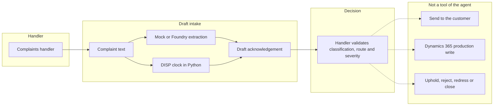
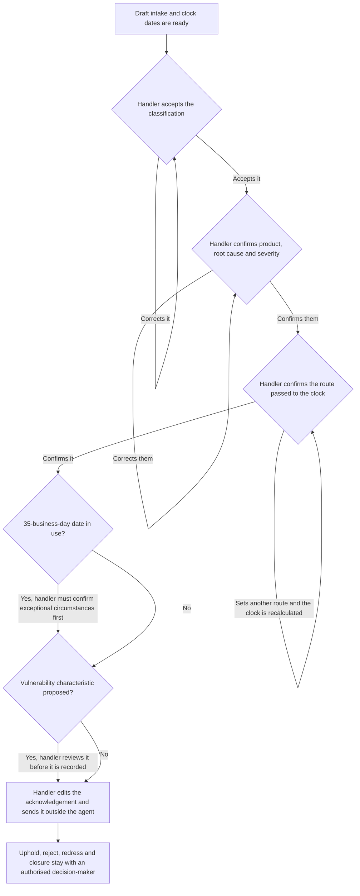

# FCA Consumer Duty Complaint Handling AI Agent (Copilot Studio and Microsoft Foundry)

A starter for FCA-regulated complaints teams. It structures one inbound complaint, calculates DISP dates in code, and leaves every classification to a handler. The agent never decides the outcome, never sends a response, and never writes a production case.

It prepares a reading of one complaint: whether the text meets the Handbook definition of a complaint, a product and a root cause, characteristics a handler should review, the DISP clock, the Consumer Duty outcome the facts appear to touch, and a draft acknowledgement. Autonomy is **A1**. The handler validates every classification and every severity. The complaints in this repository are synthetic. The optional model step, which is described and not built, is Microsoft Foundry (formerly Azure AI Foundry).

Catalogue ID **C006**. Experiment 02 of the Copilot Agent Experiments catalogue.

## Who this is for

- Complaints handlers and complaints operations managers in UK banks, building societies, insurers, payment institutions, e-money institutions, consumer credit firms, and claims management companies.
- Consumer Duty champions who need a complaint mapped to a Consumer Duty outcome without the tool deciding that the firm has breached the Duty.
- Compliance and conduct-risk teams reviewing a DISP clock that is arithmetic, not a model guess.
- Data protection officers reviewing a least-privilege design before any live complaint is processed.
- Solution architects working in Copilot Studio, Microsoft Foundry, Power Platform, and Dynamics 365 Customer Service.

A customer chatting with this agent is a different product. It is out of scope.

## The problem

[DISP](https://handbook.fca.org.uk/handbook/disp1/disp1s6) requires a firm to recognise a complaint, acknowledge it, and respond within a fixed time. The time depends on the kind of complaint. The summary-resolution route is three business days. The usual final response is eight weeks. An electronic-money or payment-services complaint is 15 business days, or 35 in exceptional circumstances. The Financial Ombudsman Service has its own referral windows. Missing a date, or letting a model invent one, is a conduct failure.

The Consumer Duty ([PRIN 2A](https://handbook.fca.org.uk/handbook/prin2a/prin2as1)) asks firms to look at whether a complaint shows a problem in products and services, price and value, consumer understanding, or consumer support. [FG21/1](https://www.fca.org.uk/publication/finalised-guidance/fg21-1.pdf) asks firms to notice a characteristic of vulnerability and respond to the need, without sticking the label "vulnerable" on the customer.

Handlers still have to read the email, the form, or the transcript and work this out. The agent prepares that reading. The handler decides.

## What it does

`src/disp_clock.py` calculates the dates. It does not call a model and it does not use the network. The same inputs always produce the same JSON. The clock is England and Wales.

| Clock | Rule | What the code does |
| --- | --- | --- |
| Summary resolution route closes | [DISP 1.5](https://handbook.fca.org.uk/handbook/disp1/disp1s5) | Close of the third business day following the day of receipt. The day of receipt is not counted. |
| Acknowledgement | [DISP 1.6.1R](https://handbook.fca.org.uk/handbook/disp1/disp1s6) | "Prompt". The Handbook sets no number of days, so the clock does not invent one. |
| Final or other written response | [DISP 1.6.2R](https://handbook.fca.org.uk/handbook/disp1/disp1s6) | End of eight weeks after receipt, implemented as 56 days. The date is not moved if it falls on a weekend or a bank holiday. |
| E-money or payment-services final response | [DISP 1.6.2AR](https://handbook.fca.org.uk/handbook/disp1/disp1s6) | End of 15 business days after the day of receipt. If a person has flagged exceptional circumstances, a holding response by day 15 and a final response by day 35. Without the provider's closed dates, those dates are a non-operative reference. |
| Ombudsman, if the firm has not responded | [DISP 2.8.1R](https://handbook.fca.org.uk/handbook/disp2/disp2s8) | The day after the firm's deadline, once that period has elapsed. |
| Six months to refer | [DISP 2.8.2R(1)](https://handbook.fca.org.uk/handbook/disp2/disp2s8) | Runs from the date the firm sent the final response, redress determination, or summary resolution communication. |
| Six years / three years | [DISP 2.8.2R(2)](https://handbook.fca.org.uk/handbook/disp2/disp2s8) | The later of six years after the event and three years after awareness. Awareness is an input. The clock does not infer it. |

`src/intake.py` is a keyword stand-in for extraction and the draft. It is tuned to the 22 synthetic fixtures. It is not a model. The build notes describe a later shape: Copilot Studio for the handler, Microsoft Foundry for extraction and the draft, and the clock remaining in Python. Dynamics 365 Customer Service is described as a boundary. This repository does not connect to it.

Two Copilot Studio harnesses are documented. Both call the same clock and stop at the same approval points. The standard harness is topics and one clock action. The GitHub Copilot harness is a Copilot Studio runtime for follow-up questions on the same draft. It is not the GitHub Copilot service. Read [docs/harness-comparison.md](docs/harness-comparison.md) before choosing. Do not upload the skills onto the standard-harness agent.

## What it does not do

Autonomy is A1. A0 would be analysis with no suggested action. A2 would allow low-risk actions without a fresh approval. A3, an agent that acts on its own, is rejected by the manifest schema and is not offered.

The agent does not:

- decide that a complaint is upheld, rejected, or resolved
- decide redress, a refund, a goodwill payment, or a waiver of fees
- send the acknowledgement, a summary resolution communication, a holding response, or a final response
- create, update, resolve, or close a Dynamics 365 case, or write any other production record
- refer a complaint to the Financial Ombudsman Service, or decide that the Ombudsman can or cannot consider it
- decide exceptional circumstances, eligible-complainant status, or that a time limit is waived
- label a customer as vulnerable, or write a vulnerability marker onto a customer record
- decide that the firm has breached the Consumer Duty
- give legal, regulatory, or case-outcome advice
- calculate DISP dates inside a model
- use a Scottish or Northern Ireland bank-holiday calendar, or forecast a one-off proclaimed bank holiday

A handler can still do those things afterwards, in the firm's own systems, under the firm's own security role. The agent has no tool for them.

## Architecture

The handler supplies one complaint and the receipt date. Extraction proposes a classification. The Python clock calculates dates from inputs the handler has confirmed. The draft copies those dates and says it must not be sent as it stands. The handler then validates every classification and the severity.



The dotted lines are a person working in the firm's own systems after the draft is accepted. The rendered picture is [docs/architecture_diagram.png](docs/architecture_diagram.png). The longer note is [docs/architecture.md](docs/architecture.md).

| Piece | Role |
| --- | --- |
| `src/disp_clock.py` | Deterministic DISP dates. Standard library only. |
| `src/intake.py` | Keyword stand-in for extraction and the draft. |
| [copilot-studio/](copilot-studio/README.md) | Standard harness build guide. Not an importable solution. |
| [skills/](skills/) and [docs/github-copilot-harness.md](docs/github-copilot-harness.md) | GitHub Copilot harness. Same clock, same approval points. |
| [docs/foundry.md](docs/foundry.md) | Optional Microsoft Foundry extractor and drafter. No resource is created here. |
| [docs/dynamics-365-customer-service.md](docs/dynamics-365-customer-service.md) | Read-only or draft-only boundary. Not connected. |
| [agent-manifest.yaml](agent-manifest.yaml) | Permissions, approval points, and the controls that stay off. |

## Human approval

Every classification and every severity is validated by a handler before it is relied on. Sending and filing stay outside the agent even after the handler accepts the draft.



| Decision | Who | Before anyone relies on it |
| --- | --- | --- |
| Accept or correct the classification | Complaints handler | Yes |
| Confirm product, root cause, and severity | Complaints handler | Yes |
| Confirm the route passed into the clock | Complaints handler | Yes |
| Confirm exceptional circumstances before a 35-business-day date is used | Complaints handler | Yes |
| Review a vulnerability characteristic before it is recorded | Complaints handler | Yes |
| Edit and send the acknowledgement | Complaints handler | Yes. The agent only drafts. |
| Uphold, reject, redress, or close | Authorised complaints decision-maker | Outside the agent. |

Viewing a draft, re-running extraction on the same text, and calculating the clock from inputs the handler has already typed do not need a separate approval. Relying on a suggested payment-services route does.

## Governance

The control record is [agent-manifest.yaml](agent-manifest.yaml), version 0.1.0, reviewed for this starter on 24 October 2026. If this README and the manifest disagree, the manifest is the control. Contacts in the manifest use `example.com`. They are placeholders.

### Least privilege

A run may read the complaint text the handler supplies, the receipt date, and, if the handler has confirmed them, the route and the provider's closed dates. It may read the static instructions. The Python starter does not persist the text.

It must not read Dynamics 365 production data, customer vulnerability markers, core banking or policy systems, mailboxes, Financial Ombudsman Service systems, or other customers' complaints. Writes are disabled. Sends are disabled. Approve or reject, a regulated decision, a production record change, an external send, and spending are disabled. Referring to the Ombudsman and labelling the customer as vulnerable are also disabled.

Allowed tools are the local DISP clock, text analysis for the draft, and a schema check that rejects a prohibited decision. None of those tools has a side effect outside the draft.

### Permissions manifest

[agent-manifest.yaml](agent-manifest.yaml) is validated in CI against [schemas/agent-manifest.schema.json](schemas/agent-manifest.schema.json). The schema permits autonomy A0, A1, and A2, and rejects A3. The invalid fixtures in [tests/fixtures/](tests/fixtures/) are checked to make sure they still fail. Level definitions are in [docs/autonomy-levels.md](docs/autonomy-levels.md). The narrative version of the same controls is [docs/security-and-permissions.md](docs/security-and-permissions.md).

### UK GDPR and the Data Protection Act 2018

This starter does not decide the firm's lawful basis. The data protection officer confirms it before any production use.

The manifest's lead basis is [UK GDPR Article 6(1)(c)](https://www.legislation.gov.uk/eur/2016/679/article/6), legal obligation. The text, read on legislation.gov.uk on 19 November 2026, says:

> processing is necessary for compliance with a legal obligation to which the controller is subject;

Article 6(3) says the basis for that processing shall be laid down by domestic law. DISP is the obligation a firm would be pointing at. [Article 6(1)(b)](https://www.legislation.gov.uk/eur/2016/679/article/6) may also be relevant where the complaint is about performing the customer contract. This page does not choose between them.

Complaint text can contain special-category data. [UK GDPR Article 9(1)](https://www.legislation.gov.uk/eur/2016/679/article/9), read the same day, says:

> Processing of personal data revealing racial or ethnic origin, political opinions, religious or philosophical beliefs, or trade union membership, and the processing of genetic data, biometric data for the purpose of uniquely identifying a natural person, data concerning health or data concerning a natural person's sex life or sexual orientation shall be prohibited.

The manifest does **not** assert an Article 9 condition. [Schedule 1 to the Data Protection Act 2018](https://www.legislation.gov.uk/ukpga/2018/12/schedule/1) is where a firm looks for a condition once it has chosen one. This starter does not claim that any paragraph of Schedule 1 applies. The customer is not labelled vulnerable, nothing is written to a customer record, and a handler reviews a flag before it is recorded. The starter makes no solely automated decision: a handler validates every classification.

Production inference, if a firm later switches it on, should run in Microsoft Foundry in UK South or UK West. Confirm the data-use terms at deployment. This README is not a data protection impact assessment. The [Data Protection Act 2018](https://www.legislation.gov.uk/ukpga/2018/12/contents) and the firm's own retention schedule apply to whatever the handler then saves. This starter keeps no store.

### FCA Consumer Duty (PRIN 2A)

Handbook pages below were opened on 19 November 2026.

[PRIN 2.1.1R, Principle 12](https://handbook.fca.org.uk/handbook/prin2/prin2s1), Consumer Duty:

> A firm must act to deliver good outcomes for retail customers.

[PRIN 2A.1](https://handbook.fca.org.uk/handbook/prin2a/prin2as1), Application and purpose, says:

> The retail customer outcome rules and guidance at PRIN 2A.3 to PRIN 2A.6 set out firms’ key obligations in relation to product governance, price and value, consumer understanding and supporting consumers.

The same page, in its guidance on the distribution chain, uses the Handbook labels PRIN 2A.3 (products and services), PRIN 2A.4 (price and value) and PRIN 2A.6 (customer support). The intake maps a complaint onto those outcomes for a human to accept or change. It does not decide that the firm has breached the Duty.

[PRIN 2A.2](https://handbook.fca.org.uk/handbook/prin2a/prin2as2), Cross-cutting obligations, includes these rules:

> A firm must act in good faith towards retail customers.

> A firm must avoid causing foreseeable harm to retail customers.

> A firm must enable and support retail customers to pursue their financial objectives.

The FCA's overview of the Duty is at [fca.org.uk/firms/consumer-duty](https://www.fca.org.uk/firms/consumer-duty).

### DISP complaint rules

[DISP 1.6](https://handbook.fca.org.uk/handbook/disp1/disp1s6), opened on 19 November 2026, was last updated on 1 June 2026 and showed a future version dated 25 October 2027. This repository encodes the text retrieved for the experiment on 24 October 2026, not that future version. [DISP 1.5](https://handbook.fca.org.uk/handbook/disp1/disp1s5) was last updated on 1 April 2018. [DISP 2.8](https://handbook.fca.org.uk/handbook/disp2/disp2s8) was last updated on 13 January 2018.

**What a complaint is.** Glossary definition ["complaint"](https://handbook.fca.org.uk/glossary/G197), limb (3), which applies in PRIN and in DISP 1.1:

> any oral or written expression of dissatisfaction, whether justified or not, from, or on behalf of, a person about the provision of, or failure to provide, a financial service, claims management service or a redress determination, which alleges that the complainant has suffered (or may suffer) financial loss, material distress or material inconvenience.

The wider DISP definition, limb (2) on the same page, also requires a connection to an activity under the Financial Ombudsman Service's jurisdiction. The agent proposes a view. The handler confirms it. A dissatisfaction that alleges none of those harms is flagged rather than forced onto the clock.

**Summary resolution.** [DISP 1.5](https://handbook.fca.org.uk/handbook/disp1/disp1s5):

> The following rules do not apply to a complaint that is resolved by a respondent by close of business on the third business day following the day on which it is received: (1) the complaints time limit rules; and (2) the complaints forwarding rules.

DISP 1.6 refers to that rule as DISP 1.5.1R. On the same DISP 1.5 page, under "When a complaint is resolved":

> A complaint is resolved where the complainant has indicated acceptance of a response from the respondent, with neither the response nor acceptance having to be in writing.

The clock does not decide that the complainant has accepted. The experiment treats that sentence as DISP 1.5.2AR. Confirm the rule number on the Handbook page before you rely on the citation.

**Acknowledgement.** [DISP 1.6.1R](https://handbook.fca.org.uk/handbook/disp1/disp1s6):

> On receipt of a complaint, a respondent must: (1) send the complainant a prompt written acknowledgement providing: (a) early reassurance that it has received the complaint and is dealing with it; and (b) a statement explaining that the respondent will send: (i) in the case of an EMD complaint or a PSD complaint: (A) a final response within 15 business days of its receipt of the complaint, in accordance with DISP 1.6.2AR(1); or (B) in exceptional circumstances, a holding response within 15 business days of its receipt of the complaint and a final response within 35 business days of its receipt of the complaint, in accordance with DISP 1.6.2AR(2); or (ii) in the case of any other complaint, a written response within 8 weeks of its receipt of the complaint, that being either a final response in accordance with DISP 1.6.2R(1) or a written response in accordance with DISP 1.6.2R(2); and (2) ensure the complainant is kept informed thereafter of the progress of the measures being taken for the complaint's resolution.

**Eight weeks.** [DISP 1.6.2R](https://handbook.fca.org.uk/handbook/disp1/disp1s6):

> Subject to DISP 1.6.2AR, the respondent must, by the end of eight weeks after its receipt of the complaint, send the complainant:

The rule then requires either a final response, or a written response which explains why the firm is not in a position to make a final response and indicates when it expects to provide one. A final response accepts the complaint and, where appropriate, offers redress or remedial action; offers redress or remedial action without accepting the complaint; or rejects the complaint and gives reasons for doing so. It also gives the Financial Ombudsman Service information required by the rest of DISP 1.6.2R. The agent does not produce that decision. DISP 1.6.4R, written acceptance that can disapply the eight-week rule for a non-payment-services complaint, is described in the clock output and is not applied automatically.

**Fifteen and thirty-five business days.** [DISP 1.6.2AR](https://handbook.fca.org.uk/handbook/disp1/disp1s6):

> Where a complaint is an EMD complaint or a PSD complaint, the respondent must: (1) send a final response to the complainant by the end of 15 business days after the day on which it received the complaint; or (2) in exceptional circumstances, if a final response cannot be given in accordance with paragraph (1) for reasons beyond the control of the respondent: (a) send a holding response to the complainant by the end of 15 business days after the day on which it received the complaint, clearly indicating the reasons for the delay in answering the complaint and specifying the deadline by which it will send the final response; and (b) send a final response to the complainant by the end of 35 business days after the day on which it received the complaint.

The same section says that where only part of a complaint is an EMD or PSD complaint, that part must be treated under DISP 1.6.2AR, and that a firm may choose to treat the whole complaint under the shorter rule. The clock keeps both dates and does not make that choice. Exceptional circumstances are a flag a person sets.

**Two meanings of "business day".** Glossary ["business day"](https://handbook.fca.org.uk/glossary/G120):

> (1) (except in CASS 10A, CASS 15, SUP 3A, SUP 16.14A, DISP 1.6.2A and DISP 2.8) (in relation to anything done or to be done in (including to be submitted to a place in) any part of the United Kingdom): (a) (except in REC) any day which is not a Saturday or Sunday, Christmas Day, Good Friday or a bank holiday in that part of the United Kingdom;

> (3) (in CASS 10A, CASS 15, SUP 3A, SUP 16.14A, DISP 1.6.2A and DISP 2.8) (in accordance with regulation 2(1) of the Payment Services Regulations) any day on which the relevant payment service provider is open for business as required for the execution of a payment transaction.

DISP 1.5 uses limb (1)(a). This module uses the England and Wales bank-holiday calendar published at [gov.uk/bank-holidays](https://www.gov.uk/bank-holidays). DISP 1.6.2A and the business-day periods in DISP 2.8 use limb (3). A provider can be open on a Saturday or on a bank holiday. Until the handler supplies those closed dates, the 15-day and 35-day figures are a non-operative reference. They are not the legal deadline.

**Ombudsman time limits.** [DISP 2.8.1R](https://handbook.fca.org.uk/handbook/disp2/disp2s8) begins:

> The Ombudsman can only consider a complaint if: (1) the respondent has already sent the complainant its final response or summary resolution communication; or (2) in relation to a complaint that is not an EMD complaint or a PSD complaint, eight weeks have elapsed since the respondent received the complaint; or (2A) in relation to a complaint that is an EMD complaint or a PSD complaint: (a) 15 business days have elapsed since the respondent received the complaint and the complainant has not received a holding response as described in DISP 1.6.2A R(2)(a); or (b) where the complainant has received a holding response, 35 business days have elapsed since the respondent received the complaint; or

The rule continues with a redress-scheme limb and with cases where the respondent consents. [DISP 2.8.2R](https://handbook.fca.org.uk/handbook/disp2/disp2s8) begins:

> The Ombudsman cannot consider a complaint if the complainant refers it to the Financial Ombudsman Service: (1) more than six months after the date on which the respondent sent the complainant its final response, redress determination or summary resolution communication; or (2) more than: (a) six years after the event complained of; or (if later) (b) three years from the date on which the complainant became aware (or ought reasonably to have become aware) that he had cause for complaint;

The rule then sets out the "unless" conditions, including exceptional circumstances and the respondent's consent. The clock does not apply DISP 2.8.2R(3) to (5), and it does not decide that the Ombudsman can consider the complaint. The wording required by DISP 1 Annex 3R is not copied here. That page was not opened for the experiment.

### Vulnerable customers (FG21/1)

[FG21/1](https://www.fca.org.uk/publication/finalised-guidance/fg21-1.pdf), Guidance for firms on the fair treatment of vulnerable customers (February 2021), paragraph 2.5:

> Our definition of vulnerability refers to customers who, due to their personal circumstances, are especially susceptible to harm, particularly when a firm is not acting with appropriate levels of care. Firms should think about vulnerability as a spectrum of risk. All customers are at risk of becoming vulnerable and this risk is increased by characteristics of vulnerability related to 4 key drivers.

The four drivers in that paragraph are health (health conditions or illnesses that affect ability to carry out day-to-day tasks), life events (such as bereavement, job loss or relationship breakdown), resilience (low ability to withstand financial or emotional shocks), and capability (low knowledge of financial matters or low confidence in managing money, and low capability in other relevant areas such as literacy or digital skills).

Paragraph 2.9:

> Consumers may not want the label ‘vulnerable’ applied to them. While we refer to customers as being vulnerable throughout this Guidance, we suggest that firms do not use this label in their interactions with consumers. Instead, firms should focus on what harm or disadvantage customers may be vulnerable to and how they can respond appropriately.

The agent may flag a driver and quote the words that prompted it. It does not label the customer, and it does not write a marker to a customer record. A handler reviews the flag before it is recorded anywhere. The flag can be special-category data. See the UK GDPR section above.

## Quick start

Python 3.10 or newer. No cloud credentials and no network. The clock uses the standard library.

```bash
git clone https://github.com/rahul-bachina/consumer-duty-complaints-copilot-agent.git
cd consumer-duty-complaints-copilot-agent
python -m pip install -r requirements.txt -r requirements-dev.txt
python -m pytest tests/ -v
python eval/evaluate.py
python src/disp_clock.py --received 2026-01-02 --route general
```

`eval/evaluate.py` prints a mock smoke test. `eval/smoke_report.json` is that run saved so a reviewer can read it without re-running. It is not a model score.

One general complaint, received Friday 2 January 2026, England and Wales:

- Summary resolution route closes on Wednesday 7 January 2026.
- Final response is due by the end of Friday 27 February 2026.
- If no qualifying response has been sent, the DISP 2.8.1R referral point used here is Saturday 28 February 2026.

A payment-services complaint received Thursday 24 December 2026. On the England and Wales reference calendar the 15th business day is Tuesday 19 January 2027. That date is not operative until the handler confirms the provider's opening days.

```bash
python src/disp_clock.py --received 2026-12-24 --route psd
python src/disp_clock.py --received 2026-01-05 --route psd --psp-use-england-wales-calendar
```

The second command is operative only because the flag asserts that this provider is closed on England and Wales weekends and bank holidays. A proclaimed extra bank holiday is passed in:

```bash
python src/disp_clock.py --received 2020-05-01 \
  --extra-closed 2020-05-08 --cancel-bank-holiday 2020-05-04
```

The same clock as a module:

```bash
python -m src.disp_clock --received 2026-01-02 --route general
python -m src.intake --received 2026-10-01 --input examples/sample_complaint.txt
```

**Copilot Studio.** There is no solution file to import. Follow [copilot-studio/README.md](copilot-studio/README.md) for the standard harness and paste the instructions in [copilot-studio/system-prompt.md](copilot-studio/system-prompt.md). The only action in that guide is a flow that returns the clock JSON and then stops. Do not add 15 working days with the flow's own calendar. The GitHub Copilot harness is [docs/github-copilot-harness.md](docs/github-copilot-harness.md), with skills under [skills/](skills/). Building that harness in a tenant consumes Copilot Credits. Prices are not stated here. Do not paste a real complaint into a shared test environment.

**Microsoft Foundry.** [docs/foundry.md](docs/foundry.md) describes one extraction call with a JSON schema. The complaint is a user message, not part of the instructions. The model is told not to calculate dates. No Foundry resource is created by this repository.

**Dynamics 365 Customer Service.** Not connected. The handler pastes the complaint. A later read, or a draft-only custom table, is described in [docs/dynamics-365-customer-service.md](docs/dynamics-365-customer-service.md). The manifest has to change in the same change as any connector.

## Evaluation results

`eval/evaluate.py` ran the keyword stand-in over the 22 synthetic cases in `eval/synthetic_dataset.json`. The saved report is `eval/smoke_report.json`.

| | |
| --- | --- |
| Mode | Mock smoke test |
| Cases | 22 |
| Passed | 22 |
| Failed | 0 |
| Errors | 0 |
| Agreement with the fixture labels | 100% |
| Model called | No |

The 22 cases cover a current-account fee, a savings rate, loan arrears after redundancy, credit-card fraud, a declined motor claim, a home claim while the customer is in hospital, a pension letter the customer does not understand, a missing Faster Payment, a locked e-money wallet, three texts that are not complaints, a dissatisfaction that alleges no harm, three prompt-injection attempts (uphold and pay, send the email, label the customer), two stale-data attempts, a bereavement, a mixed payment and e-money complaint, a complaint made for someone else, and a collections transcript in which the customer cannot buy food.

That 100% is the stand-in agreeing with labels it was tuned to. It is not a measure of model accuracy. A live Microsoft Foundry run has not been done. The DISP dates inside the run are the deterministic calculation.

The unit tests cover the England and Wales bank-holiday list used by the clock, prompt injection, stale dates, and the approval points named in the skills.

## Limitations

- The standing bank-holiday pattern matches the GOV.UK England and Wales list for 2021 and 2024–2028, which was the list read on 24 October 2026. It does not include one-off proclamations. Early May 2020 and the spring bank holiday in 2022 were moved. The coronation bank holiday on 8 May 2023 is not included unless the caller passes it.
- Scotland and Northern Ireland need a different closed-day set. Glossary limb (1)(a) is "in that part of the United Kingdom".
- "Eight weeks after" is implemented as 56 days. "Six months after" and the six-year and three-year periods use the corresponding date, or the last day of the month if that day does not exist. The Ombudsman decides a dispute about the count.
- The day after the firm's deadline is used as the first day the complainant may refer under DISP 2.8.1R, because the firm has until the end of the deadline day. Confirm this with the firm's own procedure if it uses a more cautious internal date.
- DISP 1.6.4R is described and is not applied automatically. The wording required by DISP 1 Annex 3R is not copied.
- The mock smoke test is not a model score. Residual risk in the manifest is not all Low. A wrong classification can still make a handler miss a date. The handler is the control.
- Copilot Credit prices, and which licence includes which harness, were not copied. The full standard-harness licensing article was not opened.
- This is not legal advice and it is not a statement of any firm's compliance.

## FAQ

### Does this agent decide whether a complaint is upheld?

No. Uphold, reject, redress, and closure are listed in `decisions_not_taken` and are disabled in the manifest. An authorised complaints decision-maker does that work outside the agent.

### Is the 100% evaluation a model accuracy score?

No. It is a mock smoke test of a keyword stand-in tuned to 22 synthetic fixtures. No model was called. A live Microsoft Foundry run has not been done.

### Can I import a Copilot Studio solution from this repository?

No. The Copilot Studio notes are a build guide. You create the agent in your tenant, paste the instructions, and call the clock. There is nothing to import.

### Which bank-holiday calendar does the clock use?

England and Wales, from the standing pattern on GOV.UK. It is not Scotland or Northern Ireland. A proclaimed extra bank holiday has to be passed in. For a payment-services complaint, the 15-day and 35-day dates stay non-operative until the handler supplies the days that provider is closed.

### Does it label vulnerable customers?

No. It may flag one of the four FG21/1 drivers and quote the words that prompted the flag. `customer_labelled_vulnerable` is false. Nothing is written to a customer record. A handler reviews the flag before it is recorded.

### What leaves the machine if I only run the Python?

Nothing. `src/disp_clock.py` and `src/intake.py` do not call the network. A Microsoft Foundry call is described in `docs/foundry.md` and is not made by the tests. Do not paste a real complaint into a shared tenant while you are trying the harness notes.

### Can a payment firm treat the 15-day date as the legal deadline?

Only after a person has confirmed that provider's opening days, or has asserted that the provider is closed on the England and Wales weekend and bank-holiday calendar. Until then the date is a reference. The glossary definition used for DISP 1.6.2A is the day the provider is open for a payment transaction, which is not the same as a bank holiday.

### Is this legal advice?

No. The Handbook quotations are here so a buyer or an engineer can see which rule the code is implementing, and from which page, on the day the page was opened. The firm, its compliance team, and its data protection officer confirm how the rules apply to that firm.

## Part of the Copilot Agent Experiments catalogue

This repository is experiment 02, catalogue ID C006, published on its own so it can be found, read, and cited without the rest of the catalogue.

- Source catalogue: [https://github.com/rahul-bachina/copilot-agent-experiments](https://github.com/rahul-bachina/copilot-agent-experiments)
- Catalogue site: [https://rahul-bachina.github.io/copilot-agent-experiments/](https://rahul-bachina.github.io/copilot-agent-experiments/)
- Experiment folder in the catalogue: [experiments/02-consumer-duty-complaint-intake](https://github.com/rahul-bachina/copilot-agent-experiments/tree/main/experiments/02-consumer-duty-complaint-intake)

## Work with me

Rahul Bachina is a UK solution architect (Power Platform, Copilot Studio, Microsoft Foundry, Azure AI, GitHub Copilot). He is available to adapt this starter for your organisation: the case system, the bank-holiday calendar, the approval chain, and the data-protection review.

Contact via GitHub: [https://github.com/rahul-bachina](https://github.com/rahul-bachina).

**LinkedIn:** TODO — add Rahul Bachina's LinkedIn profile URL here. Do not invent one.

Use the issue template [Request an adaptation for my organisation](.github/ISSUE_TEMPLATE/request-adaptation.yml). Do not include a live complaint.

## Maintenance

`.github/workflows/sync-from-hub.yml` runs at 07:00 UTC every Monday and can also be started with `workflow_dispatch`. It clones the public hub over HTTPS, copies `experiments/02-consumer-duty-complaint-intake/` onto the matching paths in this repository, and opens a pull request with [peter-evans/create-pull-request](https://github.com/peter-evans/create-pull-request) using `GITHUB_TOKEN` only if something changed. The workflow permissions are `contents: write` and `pull-requests: write`.

The copy never overwrites the standalone files listed in [.sync-ignore](.sync-ignore). That list includes `README.md`, `llms.txt`, `llms-full.txt`, `CITATION.cff`, `SECURITY.md`, `CONTRIBUTING.md`, `LICENSE`, `.github/`, `site/`, `schemas/`, and the manifest tests. After the copy, `scripts/apply_standalone_paths.py` rewrites the hub-relative schema path, the repository URL, and the package import so the tree still runs on its own. The sync does not delete a file that the hub later removes. Review the pull request. Do not merge live customer data.

For the pull request to open, the repository setting **Allow GitHub Actions to create and approve pull requests** has to be on. It is under Settings, Actions, General, Workflow permissions.

To run the same copy locally:

```bash
git clone --depth 1 https://github.com/rahul-bachina/copilot-agent-experiments.git /tmp/hub
python scripts/sync_from_hub.py /tmp/hub/experiments/02-consumer-duty-complaint-intake . --dry-run
```

## Licence

MIT Licence. See [LICENSE](LICENSE). Copyright (c) 2026 Rahul Bachina.

## Project structure

```
.
├── README.md
├── LICENSE
├── agent-manifest.yaml
├── llms.txt
├── llms-full.txt
├── CITATION.cff
├── src/
│   ├── disp_clock.py
│   └── intake.py
├── tests/
├── eval/
├── examples/
├── copilot-studio/
├── skills/
├── docs/
├── schemas/
├── scripts/
└── site/
```
